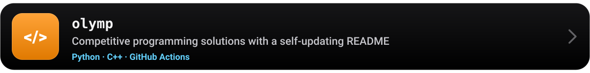
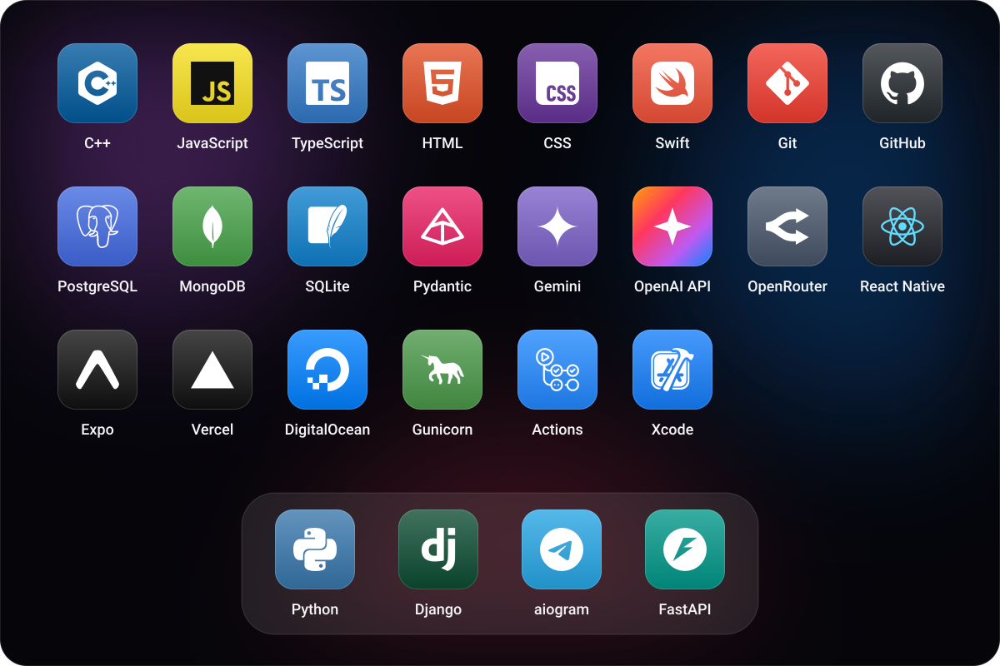
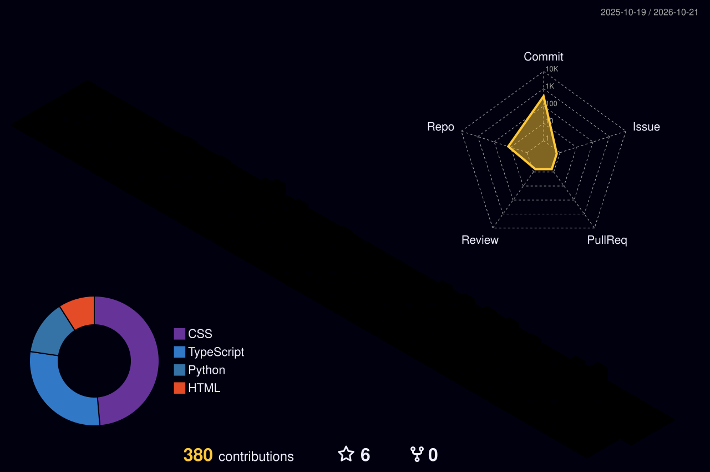
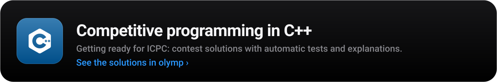

<b>English</b> &nbsp;|&nbsp; <a href="https://github.com/a1tvv/a1tvv/blob/main/README.ru.md">Русский</a>

  I am a second-year IT student at the International University of Central Asia. I am also the tech lead of a startup with two people. 
  I build Python backends with Django and FastAPI, Telegram bots and apps with AI. Right now my main focus is competitive programming in C++. 
  🇰🇿 Kazakh · 🇰🇬 Kyrgyz · 🇷🇺 Russian · 🇬🇧 English

 

 
 

 
 

<a href="https://a1tvv.github.io/a1tvv/"><b>Open the 3D view ›</b></a> Turn it, zoom in and choose any dates

 
 

 

 

