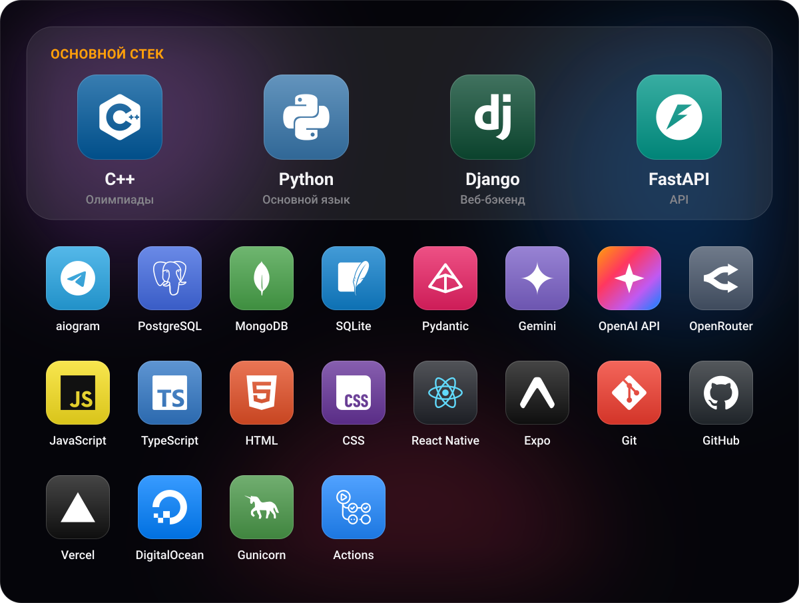

<a href="https://github.com/a1tvv">English</a> &nbsp;|&nbsp; <b>Русский</b>

  Студент второго курса IT в Международном университете Центральной Азии. А ещё техлид стартапа из двух человек. 
  Делаю Python-бэкенд на Django и FastAPI, Telegram-ботов и приложения с ИИ. Сейчас главное для меня — олимпиадное программирование на C++. 
  🇰🇿 казахский · 🇰🇬 кыргызский · 🇷🇺 русский · 🇬🇧 английский

 

 
 

 
 

<a href="https://a1tvv.github.io/a1tvv/"><b>Открыть 3D-вид ›</b></a> Крути, приближай и выбирай любые даты

 
 

 

 

